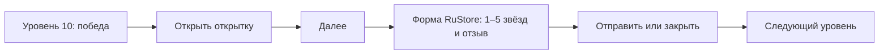

# Оценка игры через RuStore

Реализовано 1 октября 2026 года. Android, Expo SDK 56, RuStore Review SDK 10.5.1.

## Выбор момента и интерфейса

В словесном кроссворде просьба уместна на паузе после достижения: игрок уже освоил ввод слов и получил видимую награду. Первая возможность — веха открытки маршрута начиная с 10-го уровня. Сейчас это Эйфелева башня: вторая открытка после Островов Сены на уровне 5. Старые профили, которым башню выдавало прежнее обучение, также подходят при первом прохождении уровня 10: учитывается веха и показ открытки, а не дата получения изображения.

Последовательность:

1. Кроссворд решён, результат и награда сохранены.
2. Экран победы показывает прогресс и подарок. Кнопка «Открыть» показывает открытку.
3. Игрок нажимает «Далее». Открывается штатная форма RuStore поверх игры.
4. Игрок сам выбирает от одной до пяти звёзд, при желании пишет отзыв и отправляет его либо закрывает форму.
5. После завершения формы игра переходит к следующему уровню. Межстраничная реклама на этой попытке пропускается.

Дизайн формы принадлежит SDK: его не меняем, ничего поверх не добавляем. Отдельного окна с предварительными звёздами нет. Обучение, ежедневный кроссворд, повтор уже пройденного уровня, выход «В меню», финальный переход на карту и несохранённая награда не запускают форму.

Это продуктовая гипотеза для конкретной игры, а не доказанный оптимум. Порог 10 даёт время освоиться и получить две открытки, при этом не требует пройти весь город. Можно оценивать агрегированные `review_flow_finished` по результатам completed/unavailable/error; событие не содержит оценку или текст отзыва и не означает публикацию.

## Ограничения SDK

[Официальная документация 10.5.1](https://www.rustore.ru/help/sdk/reviews-ratings/kotlin-java/10-5-1) исключает вопросы о мнении и предварительные звёзды перед формой. SDK не предоставляет приложению выбранную оценку, текст отзыва или управление его публикацией. Поэтому требование «публиковать только пять звёзд» не реализовано: отправкой управляет игрок в форме RuStore. Успешный callback говорит только о завершении процесса.

Устройство должно иметь совместимый установленный RuStore, а игрок — авторизацию. RuStore сам ограничивает показы и может отказать, в том числе если отзыв уже существует. Ошибки не показываем игроку.

## Частота и устойчивость

- Автоматический запрос требует первого прохождения, открытки и минимум десяти пройденных уровней.
- Резервирование попытки сохраняется в MMKV `review.prompt.v1` до обращения к SDK.
- После завершения формы, в том числе закрытия без отправки, автоматические просьбы прекращаются.
- При недоступности или ошибке следующая попытка — не раньше 30 дней и ещё 20 пройденных уровней, на следующей вехе открытки. Всего максимум три попытки.
- При отсутствии Android-модуля (web, Expo Go, прежняя сборка) весь сценарий пропускается.
- Подготовка ограничена 1,5 секунды. Поздний ответ инвалидируется и не открывает форму после перехода.
- Открытая форма не ограничена таймером: игра ждёт callback SDK. Нативный слой проверяет foreground, ограничивает ReviewInfo четырьмя минутами и потребляет его однократно.
- Повторные нажатия защищены гардом перехода игры и гардом нативного модуля. Любая ошибка Review SDK оставляет сохранённую победу доступной для продолжения.

## Код и проверка

- `src/features/review/policy.ts` — условия и персистентная частота.
- `src/features/review/index.ts` — безопасный сценарий подготовки и запуска.
- `src/app/game.tsx` — подключение в `onNext` после раскрытия открытки.
- `modules/rustore-review/` — Android Expo-модуль, SDK и безопасные JS-обёртки.
- `plugins/withRuStoreReview.js`, `app.json` — Maven и подключение, сохраняемые при prebuild.
- `src/core/storage/index.ts` — ключ состояния; `.gitignore` — сохранение исходников локального Android-модуля с исключением его build-кэша.
- Тесты: `src/features/review/__tests__/`, `modules/rustore-review/__tests__/`, `plugins/__tests__/withRuStoreReview.test.ts`.

Переиспользован существующий экран LevelComplete: новые окна и дублирующие звёзды не добавлялись. Проверки на 1 октября: 74 набора / 380 тестов, TypeScript и ESLint прошли; `:rustore-review:compileDebugKotlin` прошёл против установленных Expo SDK 56 и RuStore SDK 10.5.1. Реальное окно и публикация отзыва на устройстве не проверены; релизный AAB в рамках этой задачи не пересобирался.

Тесты покрывают ограничения, перезапуск/повтор попытки, сломанный персист, отсутствие SDK, фон, таймаут подготовки и длительную открытую форму. Существующие тесты LevelComplete проверяют раскрытие открытки до вызова onNext. Mock callback не доказывает публикацию отзыва.

Для обновлённой Android-сборки: `npx expo prebuild -p android` (без `--clean`), существующая release-подпись, `bundleRelease`. Перед загрузкой в RuStore увеличить versionCode. Проверка реального окна и отправки требует сборки опубликованного приложения и авторизованного RuStore на тестовом устройстве; не отправлять отзывы из автоматического smoke-теста.
