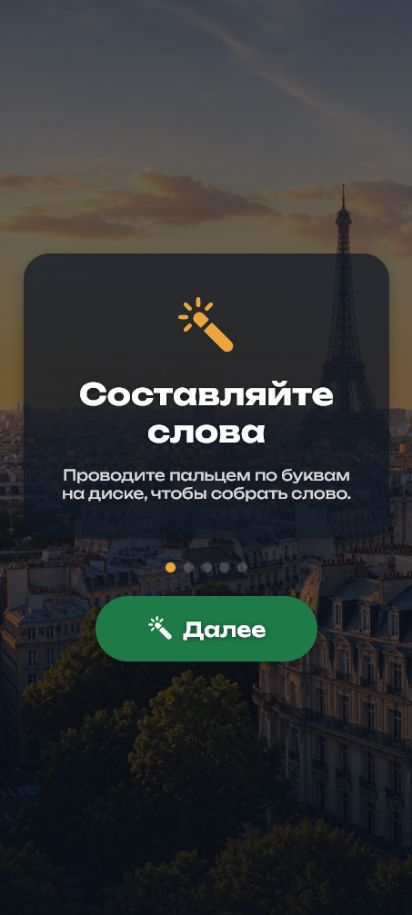
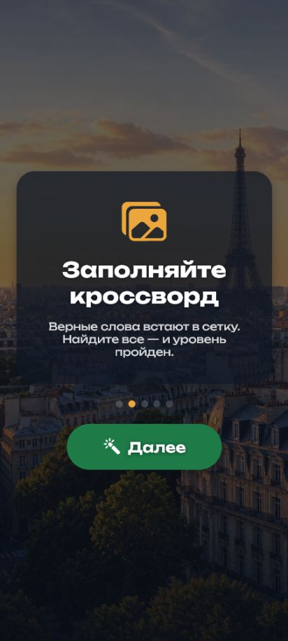
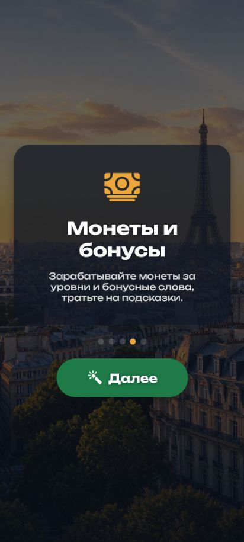
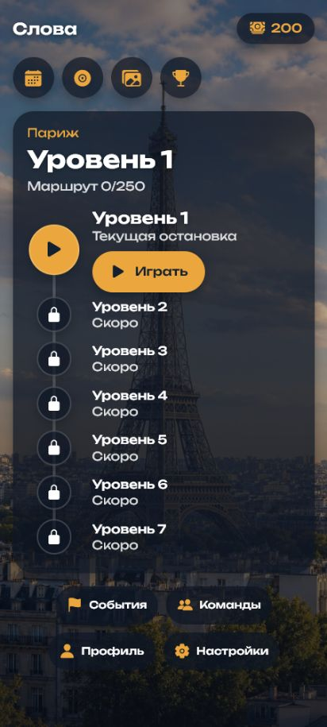
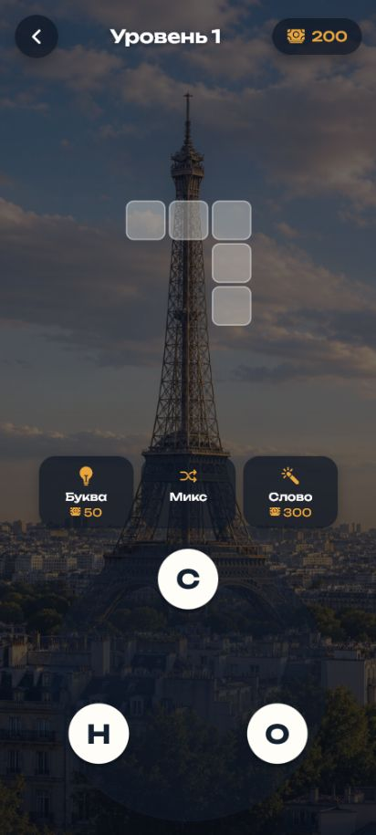
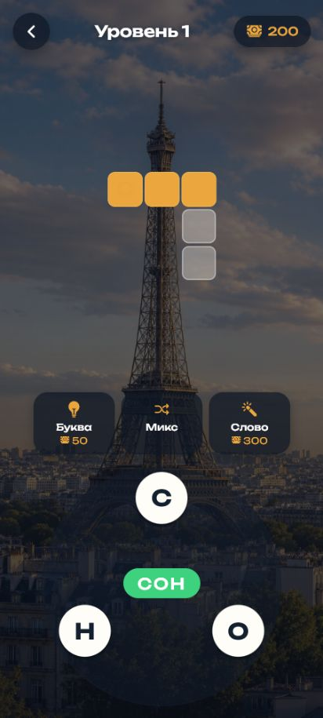
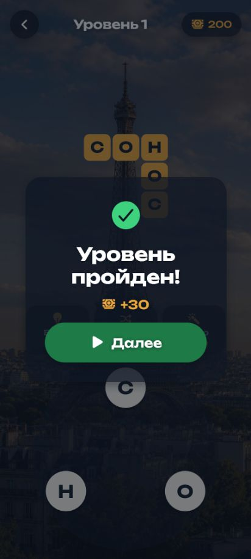
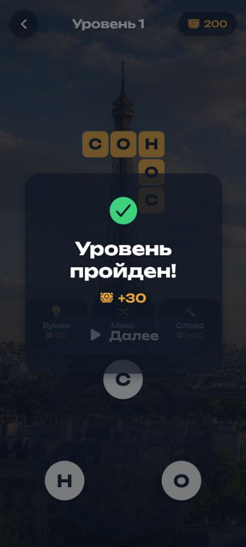
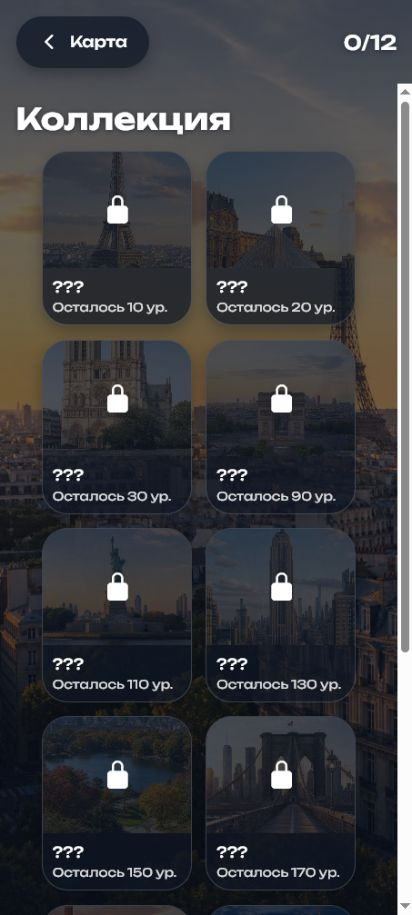

# UI и функциональный аудит Slova

Дата: 27 июля 2026  
Цель: сделать игру понятнее, надёжнее и интереснее на всей дистанции 1–250.

## Короткий вердикт

У Slova уже есть хорошая визуальная основа: цельная travel-тема, крупные основные действия, приятный момент заполнения кроссворда и понятная карта пути. Контента формально много — 250 валидных уровней, 1 062 уникальных обязательных слова, 12 достопримечательностей, ежедневная задача, колесо и социальные экраны.

Главная проблема сейчас не в количестве контента, а в работоспособности и режиссуре:

1. Текущая сборка блокирует игрока после первой победы: «Далее» становится неактивной, уровень 2 не открывается.
2. Все 250 campaign-уровней используют один и тот же тип задачи. Миры меняют фон и коллекцию, но не игровой опыт.
3. Заявленная пятиуровневая волна `easy → baseline → hard → breather → climax` почти не соответствует фактической сложности.
4. После уровня 151 начинается плато из ста 7-буквенных уровней без новой механики.
5. Качество обязательных слов и особенно бонусного словаря недостаточно отредактировано вручную.
6. Мета-награды распределены неровно: после уровня 30 следующая достопримечательность только на уровне 90.

До исправления completion-flow игра не готова к продуктовой проверке удержания: первый пользовательский цикл физически нельзя продолжить.

## Объём и метод

- Текущая Expo web-сборка была пройдена с нуля в мобильном viewport 412×915.
- Зафиксирован путь: onboarding → карта → уровень 1 → найденное слово → победа → попытка продолжить → коллекция.
- Скриншоты сделаны и проверены в рамках этого запуска; старые изображения проекта не использовались как доказательство.
- Проанализированы все 250 JSON-уровней, генератор, игровой движок, хранилище, экономика и мета-функции.
- Выполнены Jest, TypeScript, ESLint, backend-тесты и строгий content audit.

Ограничение: это не нативный device-pass. Производительность, hardware Back, TalkBack, системный font scale, рекламные SDK и Android navigation bar требуют отдельной проверки на устройстве.

## Путь игрока

### Шаг 1. Объяснение основного жеста — условно хорошо

Сильные стороны:

- один тезис на экран;
- крупный CTA;
- фон и затемнение создают цельный визуальный стиль.

Риски:

- это статичное объяснение вместо первого действия;
- нет «Пропустить» и «Назад»;
- пользователь ещё не почувствовал успех, но уже должен читать правила.

### Шаг 2. Объяснение кроссворда — условно хорошо

Формулировка понятна, но её лучше показать прямо на первом уровне: провести первое слово вместе с игроком и сразу заполнить клетки.

### Шаг 3. Подсказки до первого опыта — требует упрощения

Подсказки объясняются до того, как игрок успел застрять. Это преждевременно знакомит с расходованием валюты и удлиняет time-to-value.

### Шаг 4. Экономика до первого выигрыша — требует упрощения

Экономика понятна, но её выгоднее раскрывать после первого бонусного слова или первой победы. Сейчас обучение рассказывает о награде раньше, чем игрок испытал удовольствие от решения.

### Шаг 5. Обещание путешествия — красиво, но слишком поздно

Это самый сильный продуктовый тезис onboarding, но он появляется пятым. Стоит поднять его в первый экран и сразу отправлять в интерактивный tutorial.

### Шаг 6. Карта уровней — визуально сильная, но перегруженная

Сильные стороны:

- текущая остановка и следующий шаг видны сразу;
- travel-тема считывается;
- блокировка следующих уровней понятна.

Риски:

- четыре верхние функции представлены только иконками;
- одновременно видны два похожих элемента запуска — круглая play-кнопка и «Играть»;
- «Маршрут 0/250» на старте подчёркивает объём, но может ощущаться как длинный гринд;
- нижние пункты выглядят как набор разрозненных chips, а не устойчивая навигация.

### Шаг 7. Уровень 1 — хорошая база core gameplay

Сильные стороны:

- tutorial действительно простой: три буквы, два общеупотребительных слова, без бонусного шума;
- буквы и активная зона крупные;
- сетка и диск визуально разделены;
- фотофону помогает затемнение.

Риски:

- подсказки и цены занимают заметную часть первого игрового экрана;
- «Слово 300» показывается новому игроку с балансом 200;
- нет контекстной подсветки первого свайпа;
- диск и сетка не имеют TalkBack-семантики.

### Шаг 8. Найденное слово — приятный момент успеха

Зелёная плашка и заполнение сетки хорошо подтверждают правильный ответ. Однако отрицательные состояния показываются слишком кратко и зависят от цвета, а текстовая причина ошибки отсутствует.

### Шаг 9. Победа — визуально хорошо, смысл награды слабый

Оверлей чистый и эмоционально понятный. Награда показывается одной суммой, поэтому игрок не понимает вклад слов, бонуса за завершение или серии. Это ослабляет желание искать бонусные слова и играть «лучше», а не просто закончить.

### Шаг 10. Продолжение — критически сломано

После нажатия «Далее»:

- URL остаётся `/game`;
- кнопка получает disabled-state;
- уровень 2 не открывается;
- повторное нажатие невозможно.

Причина: completion ID попадает в сохранённый snapshot, но не в текущее состояние store. `onNext()` не может забрать награду и выходит, а локальный lock кнопки уже установлен.

Затронутые места:

- `src/features/game/store.ts:68`
- `src/features/game/store.ts:107`
- `src/features/game/store.ts:124`
- `src/features/game/persistence.ts:101`
- `src/app/game.tsx:296`
- `src/features/game/LevelComplete.tsx:37`

Нужен end-to-end тест: `complete → claim → reward → unlock → next level`.

### Шаг 11. Коллекция — понятная мета-цель с большим провалом ритма

Карточки привлекательны и сразу обещают долгосрочную цель. Но фактические unlock-границы — `10, 20, 30, 90, 110, 130, 150, 170, 190, 210, 230, 250`. После трёх быстрых наград игрок получает 60 уровней без новой достопримечательности.

## Уровни: количество и содержание

| Мир | Уровни | Глобальные ID | Обязательные слова | Среднее слов/уровень | Bonus occurrences |
|---|---:|---:|---:|---:|---:|
| Париж | 90 | 1–90 | 302 | 3,36 | 489 |
| Нью-Йорк | 80 | 91–170 | 378 | 4,72 | 1 133 |
| Москва | 80 | 171–250 | 382 | 4,78 | 1 756 |
| Итого | **250** | 1–250 | **1 062** | **4,25** | **3 378** |

Структурные сильные стороны:

- все 1 062 обязательных ответа уникальны;
- нет повторяющихся точных комбинаций букв и ответов;
- все уровни валидны и решаемы;
- размер диска растёт глобально, а не сбрасывается на границе мира;
- первый уровень вручную упрощён до `сон/нос`.

## Фактическая кривая сложности

Размер диска:

- уровень 1 — 3 буквы;
- 2–30 — 4 буквы;
- 31–80 — 5 букв;
- 81–150 — 6 букв;
- 151–250 — 7 букв.

Средние значения по крупным отрезкам:

| Уровни | Букв | Ответов | Клеток | Bonus pool | Difficulty score |
|---|---:|---:|---:|---:|---:|
| 1–10 | 3,9 | 2,5 | 7,1 | 2,6 | 69,6 |
| 11–30 | 4,0 | 2,5 | 7,4 | 3,7 | 71,0 |
| 31–60 | 5,0 | 3,7 | 12,5 | 5,9 | 93,9 |
| 61–90 | 5,3 | 3,8 | 13,3 | 7,1 | 99,1 |
| 91–120 | 6,0 | 4,7 | 18,1 | 13,0 | 114,9 |
| 121–170 | 6,4 | 4,7 | 18,1 | 14,9 | 120,1 |
| 171–200 | 7,0 | 4,9 | 21,3 | 22,5 | 129,2 |
| 201–250 | 7,0 | 4,7 | 20,3 | 21,6 | 127,9 |

Вывод: базовая сложность растёт ступенями, но последние 50 уровней в среднем немного проще уровней 171–200. После 151-го уровня нет нового системного вызова.

## Почему текущая «волна интереса» не работает

Генератор механически присваивает каждому циклу:

`easy → baseline → hard → breather → climax`

Но эти роли не управляют игровым runtime и слабо управляют самим контентом:

- только 7 из 50 пятёрок соответствуют ожидаемой полной волне сложности;
- `climax` является самым трудным лишь в 19 из 50 циклов;
- уровень 30 (`climax`) имеет score 67 после уровня 29 (`breather`) со score 83;
- финальный уровень 250 имеет четыре ответа и score 122 — это не настоящий финал;
- difficulty metadata нигде не используется для UI, наград или адаптивной сложности.

Формула также считает дополнительные пересечения усложнением, хотя уже открытые клетки часто помогают игроку.

## Содержание слов

Формальная уникальность обязательных ответов хорошая, но продуктовая редактура недостаточна.

Примеры обязательных слов низкого потребительского качества:

- `санкт`, `ква`, `кабул`;
- `нии`, `кэт`, `мэн`, `чен`;
- `личной`, `втора`, `олин`, `сема`, `лиф`, `лян`, `див`, `ладо`.

Bonus-слой повторяется сильнее:

- 3 378 появлений бонусов, но только 1 254 уникальные строки;
- 62,9% появлений — повтор уже встречавшегося бонуса;
- `сто` и `ост` встречаются по 26 раз;
- 236 из 250 уровней имеют однокоренные конфликты в объединении обязательных и бонусных слов;
- уровень 10 содержит обязательное `одни` и rewarded bonus `один`.

Текущий строгий content audit проверяет структуру, классификацию и конструктивность, но не проверяет реальную знакомость слова, интересность, однокоренные конфликты всего пула и соответствие роли сложности.

## Bonus UX

- 84 уровня имеют более 14 допустимых бонусов.
- 24 уровня имеют более 28.
- Максимум — 56 бонусов на уровне 215.
- Вознаграждаются только первые 14.

UI показывает `найдено / весь bonusPool`, например `/56`, хотя после 14-го бонуса монеты больше не выдаются. Для игрока это выглядит как незавершённая цель без честного объяснения.

## Миры и долгосрочный интерес

Миры пока являются визуальными оболочками:

- слова не подбираются по теме Парижа, Нью-Йорка или Москвы;
- нет уникальных правил мира;
- нет специальных milestone-уровней;
- финалы мира генерируются как обычные уровни;
- после 250-го уровня нет завершения путешествия или режима мастерства.

В спецификации обещаны сундуки каждые 10 уровней, но в runtime они не реализованы. Поэтому реальная мета-петля — только 12 достопримечательностей, причём одна из пауз длится 60 уровней.

## Функциональные риски

### P0 — релиз-блокер

1. После первой победы «Далее» навсегда блокируется и следующий уровень не открывается.

### P1 — высокое влияние

2. Награду ×2 потенциально можно получать повторно после выхода и возврата: idempotency ledger для удвоения отсутствует.
3. Daily, колесо и ежедневный бонус доверяют часам устройства; смена даты обновляет награды.
4. Лидерборд доверяет присланному клиентом числу пройденных уровней, поэтому рейтинг можно накручивать повторными запросами.
5. Core gameplay недоступен для TalkBack: у SVG-диска нет доступного альтернативного ввода.
6. Облачный save API существует, но прогресс и валюта фактически сохраняются только локально.
7. «Отключить аналитику» останавливает только кастомные события, но не нативный автосбор AppMetrica.

### P2 — заметные риски

8. После перезапуска на экране победы может потеряться бонус завершения уровня в 20 монет.
9. Колесо списывает попытку до выдачи награды; закрытие приложения во время анимации оставляет игрока без попытки и без награды.
10. Недоступная реклама часто не объясняется игроку.
11. Нет действия «Начать уровень заново».
12. Ошибки записи в локальное хранилище подавляются, поэтому UI может показать успех, который не сохранится.
13. Сетевые запросы не имеют timeout/cancellation.
14. Ошибки `invalid`, `duplicate` и `blocked` не объясняются текстом.
15. Нет fallback при ошибке загрузки шрифтов: splash может остаться навсегда.

## UI и accessibility

### Сильные стороны

- последовательная travel-тема;
- хороший контраст главных CTA на проверенных состояниях;
- крупные основные кнопки;
- safe area и затемнение фотофонов;
- хороший положительный feedback: заполнение клеток, цвет, анимация, звук и хаптика.

### Риски

- пять статичных onboarding-экранов задерживают первое действие;
- body-текст и подписи местами слишком мелкие для заявленной аудитории 35+;
- основной wide display-шрифт используется там, где обычный sans был бы читабельнее;
- LetterDisk и CrosswordGrid не имеют доступной семантики;
- результат неправильного слова исчезает примерно через 650 мс и зависит от цвета/motion;
- completion и другие overlay-экраны не изолируют accessibility focus и Android Back;
- нет reduced-motion;
- короткие Android viewport 360×740/800 не покрыты достаточными layout-тестами.

## Рекомендуемая новая режиссура 1–250

### 1–10: быстрый первый успех

- оставить один welcome-экран;
- сразу открыть guided level 1;
- подсветить путь `С → О → Н`;
- объяснить bonus word только при первом фактическом бонусе;
- на уровне 10 дать специально собранный landmark-финал.

### 11–30: закрепление и первая вариативность

- короткие 4-буквенные уровни;
- чередовать обычную цель с необязательными мастерскими целями: без подсказки, найти 2 бонуса, пройти серией;
- landmark/micro-reward каждые 10 уровней;
- уровень 30 — ручной climax, а не случайный набор.

### 31–80: первая новая механика

- 5 букв;
- добавить тематические наборы слов по достопримечательности;
- ввести один новый тип уровня, например «одно скрытое тематическое слово» или двухфазную сетку;
- убрать провал наград 31–90.

### 81–150: осмысленная сложность

- 6 букв;
- режиссировать волны по знакомости слов, числу ответов и плотности сетки;
- использовать breather после тяжёлого milestone;
- добавлять отдельные curated daily-пулы, а не случайный campaign ID по дате.

### 151–210: новая система, а не только седьмая буква

- 7 букв;
- добавить вторую механику или modifier;
- сократить визуальный шум бонусной цели;
- привязать слова и факты к Нью-Йорку/Москве.

### 211–249: мастерство

- использовать лучшие комбинации механик;
- давать заметные mastery-награды;
- не увеличивать сложность только редкостью слов.

### 250: настоящий финал

- вручную спроектированная сетка;
- узнаваемые слова;
- уникальная награда и финальный экран путешествия;
- переход в режим мастерства, новые путешествия или curated replay.

## Приоритетный план

### Сначала — восстановить доверие

1. Исправить completion ID и разблокировку уровня 2.
2. Добавить E2E-тест полного первого цикла.
3. Сделать reward claiming и ×2 идемпотентными.
4. Исправить crash-safe выдачу колеса и daily clock trust.

### Затем — улучшить первые 30 уровней

5. Сократить onboarding до одного экрана + guided tutorial.
6. Ручная редактура уровней 1–30 и milestone 10/20/30.
7. Добавить micro-reward каждые 5–10 уровней.
8. Дать текстовую обратную связь для ошибок и доступный tap-to-select.

### Затем — перестроить 31–250

9. Настоящий difficulty director с проверяемыми инвариантами каждой пятёрки.
10. Тематические word pools и ручные финалы миров.
11. Новые механики до 80, 150 и 210.
12. Редактура mandatory-слов, фильтр корней для всего bonus pool, ограничение повторов.
13. Честно показывать `rewarded bonus / 14`, а не ложную цель `/56`.
14. Перестроить daily rotation и защитить лидерборд серверным подтверждением результата.

## Проверки

- Jest: 18/18 suites, 74/74 теста.
- Backend: 16/16 тестов.
- TypeScript: успешно.
- Strict content audit: PASS, 250 уровней, 0 структурных ошибок.
- ESLint: 0 ошибок, 4 предупреждения.
- Воспроизведённый UI/E2E blocker: кнопка «Далее» disabled после первой победы.

Зелёные тесты подтверждают базовую структурную целостность, но не покрывают критический путь `победа → награда → следующий уровень`, реальную интересность уровней, Android accessibility и crash-recovery.
